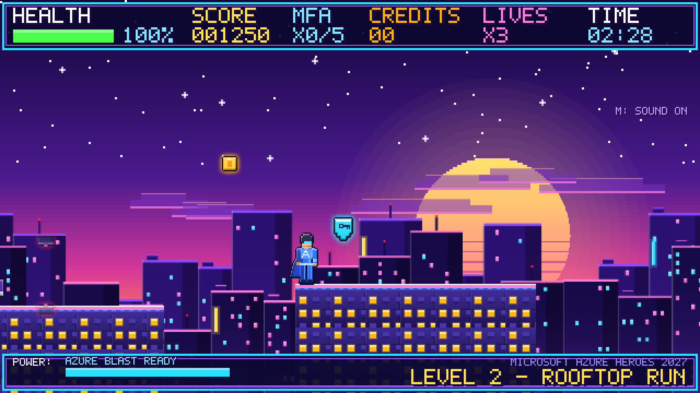
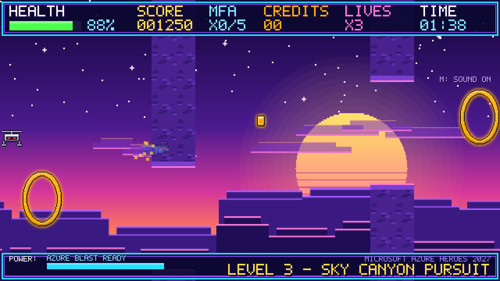
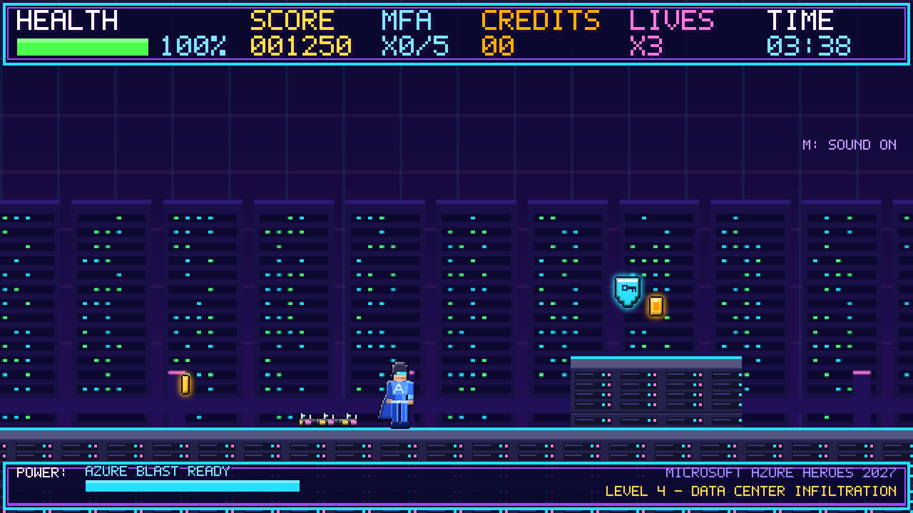
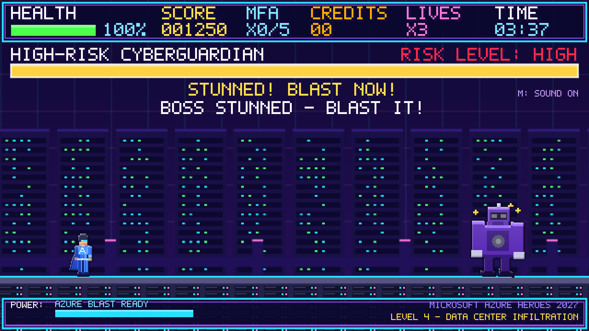

# Microsoft Azure Heroes 2027

A 16-bit synthwave side-scrolling adventure built with **Phaser 3** (loaded from a CDN), plain HTML, CSS and JavaScript. There is no build step, no backend and no image or audio files: every sprite and background is drawn in code and every sound is synthesised with the Web Audio API.


## Play

Open `index.html` in a browser (an internet connection is needed for the Phaser CDN). You can also serve the folder with any static server:

```bash
python3 -m http.server 8080
# then browse to http://localhost:8080
```

## Levels

| Level | Name | Goal |
|-------|------|------|
| 2 | Rooftop Run | Run and jump across rooftops, dodge red lasers, double jump over gaps. |
| 3 | Sky Canyon Pursuit | Auto-scrolling flight. Dodge drones and rocks, fly through gold Azure Credit rings. |
| 4 | Data Center Infiltration | Hack terminals to 100%, open Sec Gates, jump cables, avoid spider bots, then beat the High-Risk CyberGuardian. |

Collect 5 MFA tokens for an extra life. Every enemy takes 2 hits and drops an Azure Credit. Best score and unlocked levels are stored in `localStorage`.

## Controls

| Action | Keyboard | Touch |
|--------|----------|-------|
| Move | Arrow keys / WASD | Left / Right buttons |
| Jump / Double jump | Space (double-tap for double jump), Up, W | Jump button |
| Azure Blast (costs Boost) | F | Attack button |
| Flight Boost | Shift | - |
| MFA Shield (blocks boss attacks) | E, S or Down | - |
| Pause / Restart / Mute | P / R / M | Pause button |

Add `?touch=1` to the URL to force the touch controls on a desktop browser.

## Project layout

The layout follows the project skills in `.github/skills/`.

```
index.html          entry point, Phaser config, script order
art/sprites.js      every sprite, tile, background and the pixel font
ui/hud.js           read-only HUD
levels/level2-4.js  level data (see the game-contract skill)
systems/            audio and save, input, player, enemies, boss, scenes
tests/playtest.md   QA report
docs/               article and screenshots
```

## Deploy

The site is static, so no build configuration is needed.

- **GitHub Pages:** Settings > Pages > deploy from the `main` branch, root folder.
- **Azure Static Web Apps:** point the app location at the repository root, leave the API and output locations empty, and skip the build.

## Screenshots






Read the write-up in [docs/article.md](docs/article.md).
