# Microsoft Azure Heroes 2027

A 16-bit synthwave side-scrolling adventure built with **Phaser 3** (loaded from a CDN), plain HTML, CSS and JavaScript. There is no build step and there are no image or audio files: every sprite and background is drawn in code and every sound is synthesised with the Web Audio API.

The game runs fully offline as a static site. When it is hosted with the small Node.js server in `server.js` (for example on Azure App Service), players can also register, sync their progress and compete on a global high score dashboard.


## Play

Open `index.html` in a browser (an internet connection is needed for the Phaser CDN). This is guest mode: progress is saved in `localStorage`.

To play with accounts and the high score dashboard, run the server (Node.js 18 or later, no dependencies):

```bash
npm start            # http://localhost:8080 (PORT and DATA_DIR env vars are optional)
npm test             # gameplay, skills, security boundaries and API tests
```

## World map

Levels are picked on an **Azure world map**. Each pin is an Azure region. Cleared pins get a green tick and are joined by gold flight routes, and a plane flies the latest leg. Select a pin with the arrow keys or a tap, then press Enter or tap it again to deploy.

The game remembers where you left off. **C: Continue** on the title screen or map resumes the level you were playing, also after a game over (the score then restarts at zero so the high score table stays fair). After a cleared level, Continue takes you to the next one with your score and lives.

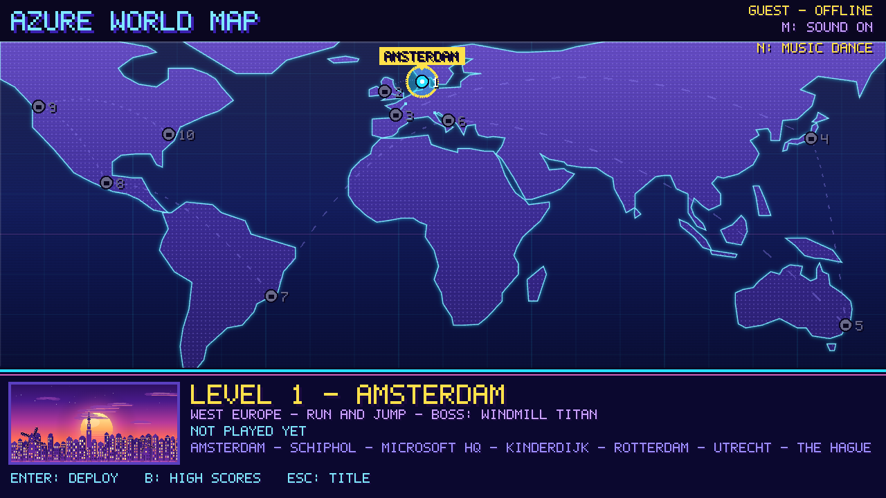
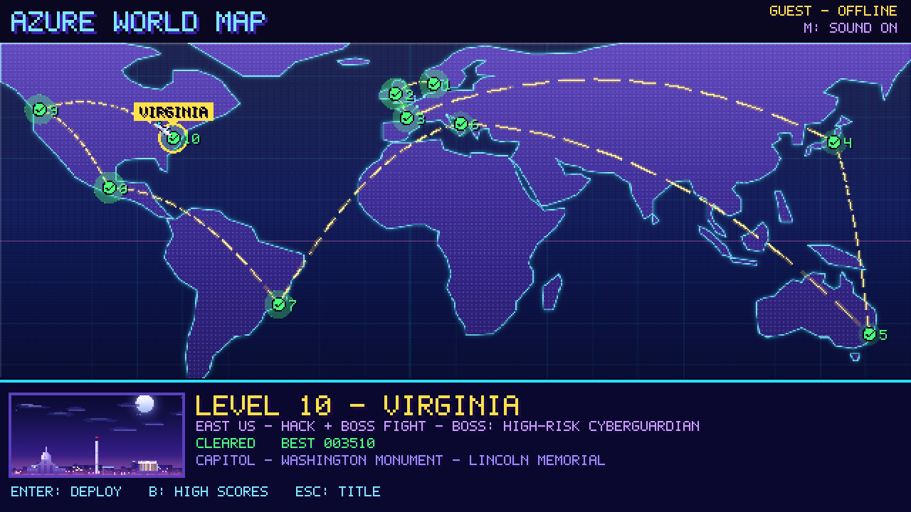

## Levels

| Level | Azure region | World | Boss | Mode |
|-------|--------------|-------|------|------|
| 1 | `westeurope` | Amsterdam Canal Run: canal houses, Centraal Station, Schiphol, Microsoft HQ, Kinderdijk, Rotterdam, The Hague | Windmill Titan | Run |
| 2 | `uksouth` | London Thames Run: Big Ben, Tower Bridge, Stonehenge, Edinburgh, Glenfinnan, a secret phone box | Bearskin Sentinel | Run |
| 3 | `francecentral` | Paris Seine Run: Eiffel Tower, Sacre-Coeur, Moulin Rouge, zinc rooftops, bakeries, bateaux-mouches, Louvre, Mont-Saint-Michel, a Metro sub-level and a ghost station | Chef de Chaos | Run |
| 4 | `japaneast` | Tokyo Skyway Pursuit: Mount Fuji, Tokyo Tower, Himeji, Osaka Castle, Shinkansen | Sumo Shogun (hovering) | Flight |
| 5 | `australiaeast` | Sydney Harbour Run: Opera House, Harbour Bridge, Uluru, Twelve Apostles | Boxing Roo | Run |
| 6 | `italynorth` | Venice Lagoon Run: Rialto, St Mark's, gondolas, Colosseum, Leaning Tower of Pisa, a Trevi portal | Gladiator Maximus | Run |
| 7 | `brazilsouth` | Rio Sugarloaf Pursuit: Christ the Redeemer, Sugarloaf, Brasilia, Iguazu | Carnaval Rei (hovering) | Flight |
| 8 | `mexicocentral` | Mexico City Skyway: Teotihuacan, Chichen Itza, Angel of Independence, hot air balloons | El Luchador Supremo (hovering) | Flight |
| 9 | `westus2` | Redmond Campus Lake Run: Microsoft campus, Space Needle, Mt Rainier, an Xbox bonus door | The Blitz Linebacker | Run |
| 10 | `eastus` | Virginia Data Center: Capitol, Washington Monument, hack terminals, Sec Gates | High-Risk CyberGuardian | Data center |

Levels are generated at random each time a level starts, so platforms, lasers, enemies, coins, power-ups and MFA tokens land in new places on every run. Run levels mix gaps, steps up, drops and floating platforms at different heights, and every region has its own coins, enemy skins, scenery props, traffic, birds and sky objects (planes, balloons, blimps, helicopters). Each run also gets a random time of day, from sunrise to night.

Every region also has cyber-threat enemies: **Phishing hoppers** leap at you, **Ransomware chargers** wind up and dash, and **DDoS botnet clouds** follow you and drop bombs. Street and data-center levels also feature pipeline bugs, vulnerable container images, overprivileged RBAC robots, exposed-endpoint turrets, stale guest-account crawlers and **Rogue Hackers** who fire from handheld terminals. Their bolts can be blocked with the MFA Shield. Defeating them reveals tips about GitHub Actions, Defender for Cloud, Entra MFA and access reviews, least privilege and Azure Private Link.

### Streets, water and secrets

Run levels are not just rooftops. The ground matches the city: canal quays and brick bridges in Amsterdam, the Thames embankment promenade in London and harbour piers in Sydney. Fall in the water and you lose a life. Canal boats and ferries carry you across. Amsterdam's pull-up bridges lift on a timer, so watch for the flashing warning before you cross.

- **Azure Bike** (Amsterdam, London): run into it to ride. It doubles your running speed (about 360 instead of 190 px/s, with a speed trail and wider look-ahead) and rams enemies, but one hit knocks you off.
- **Secret phone box** (London): stand inside for a moment to warp to a bonus room full of credits.
- **Shooting enemies**: some walkers fire bolts back at you. Streets have denser patrols, including low cloud threats that can be slide-attacked or blasted while ducking.
- **Vertical routes**: taller steps, deeper drops and more upper walkways reward jumping between street and rooftop routes. Pipe entrances and returns are reserved before hazards are placed.
- **Amsterdam street life**: look for Hollandse Haring stands, larger bicycles and more legible small-car traffic.
- **Paris street life**: boulangerie stalls on the quays, Haussmann zinc rooftops, bateaux-mouches on the Seine and Guimard Metro entrances. The Eiffel Tower, Sacre-Coeur and Moulin Rouge appear more often than other local landmarks.
- **No repeats**: a scenery strip of local landmarks and Microsoft billboards scrolls behind the street. The same landmark never shows twice on screen.

Microsoft touches: the Microsoft logo in the HUD and title, Microsoft HQ and Azure/Copilot/Xbox signs in the scenery, a Bliss-style hill, a Blue Screen game over and an Azure portal "Deployment succeeded" level-complete panel.

Every level ends in an arena with that region's boss. Bosses attack faster as their health drops, with telegraphed charges and staggered volleys. **Red health bar / ARMORED means shots cannot damage the boss. Green bar, target brackets and OPEN countdown mean fire now.** Ground bosses open after you block two shots or a charge with the MFA Shield. Jump or dodge a charge and the boss slams into the arena wall, dazed for over three seconds. All bosses overheat after three attacks, so there is always a damage opportunity. Hovering bosses must be dodged. Old bullets clear when the damage window opens. The exit opens when the boss is down. Losing a life restores defeated enemies, except those close to the checkpoint.

### Power-ups

| Orb | Effect |
|-----|--------|
| Copilot | A sidekick auto-fires Azure Blasts at nearby enemies for 12 s |
| Defender | Invincible for 8 s |
| GitHub Actions | Turbo speed for 9 s |
| Power BI | Coin magnet and double score for 12 s |
| Teams | Instant +30 health |
| Event Grid Spread | Replaces the blaster for 25 s: three fan shots, five when charged |
| Cosmos Beam | Replaces the blaster for 25 s: pierces three enemies, five when charged; stops at walls |

**Tap F and release for a quick shot; hold F up to 1.2 seconds, then release for a stronger shot.**
The touch BLAST button works the same way. The HUD shows the weapon, remaining pickup
time and charge; a glowing muzzle signals charge readiness. Charged Azure/Cosmos shots
deal up to three normal hits and use up to 20 extra Boost. Spread pellets each deal one
hit. A new weapon pickup replaces the previous one; expiry or respawn restores Azure
Blast. Shielding with E, taking damage, pausing, opening Help or warping cancels a held charge. Hold Down and F to charge a low shot: pressing F lowers the crouch guard.
Every world offers both weapon pickups, including flight and data-center levels.

Clippy warns you when health is low, and Xbox-style achievements pop up for firsts. Open the **Hero Lab** on the title screen with **E** to choose a male or female hero, skin tone, hair style, hair colour and suit colour, plus **local wardrobe** from the game's regions: a Texas cowboy hat, Mexican sombrero, London bowler, Paris beret, Dutch King's Day crown, Japanese hachimaki, Australian cork hat, Venetian gondolier hat, Rio carnaval plumes, a Redmond Azure cap, a Virginia tricorn or a hijab (its scarf colour is set on the colour row), and extras such as Dutch wooden clogs, a football scarf, a serape, a flower garland or a bandana. The choice is saved and shows in every pose, including flight.

The game renders at 1280x720 (`AH.VIEW_SCALE = 2`) while game logic stays at 640x360, so the hero, HUD and text stay sharp. The Hero Lab and title screen use a high-detail hero portrait.

**Regional wardrobe.** Each clear unlocks an outfit with a distinct garment shape,
a hairstyle and an accessory, announced on the deployment screen. Preview locked
items in Hero Lab, but clear their region before saving them. Classic wardrobe and
previously earned progress remain available. The **Cowboy** (denim western shirt,
leather vest, sheriff star, buckle), **India Kurta** (long kurta under a Nehru
jacket) and **Cloud Hacker** (capeless, with the Rogue Hacker's hood, red visor,
dark zip hoodie and portable terminal) outfits are open from the start. Cloud
Hacker has the normal abilities; choose `NONE` on the headwear row for its hood,
which hides the selected hair, or choose a hat or hijab to wear that instead.

**Gold Mode (easter egg).** On the title screen type Up, Up, Down, Down, Left,
Right, Left, Right, A. You get a golden suit and 30 lives for that browser session.
Gold runs are a sandbox: their scores are never submitted to the leaderboard and
nothing is saved (no bests, unlocks or continue point). Reload the page to leave it.

| Clear region | Outfit | Hairstyle | Accessory |
|---|---|---|---|
| Amsterdam | Canal Jacket | Canal Braid | Tulip Pin |
| London | Formal Coat | Tailored Part | Pocket Watch |
| Paris | Breton Top | Seine Waves | Silk Neckerchief |
| Tokyo | Kimono | Tidy Bun | Obi Cord |
| Sydney | Reef Vest | Surf Crop | Shell Pendant |
| Venice | Gondolier | Lagoon Sweep | Lagoon Ribbon |
| Rio | Rio Tracksuit | Rio Curls | Sport Wristbands |
| Mexico City | Charro Jacket | Ribbon Braid | Silver Bow |
| Redmond | Campus Hoodie | Campus Undercut | Campus Satchel |
| Virginia | Trail Coat | Crown Coils | Trail Compass |

**Know your threat.** Every enemy carries a nameplate coloured by category: red = malware, orange = network, pink = identity, yellow = DevOps. Press **H** for the Hero Handbook, which lists every threat and how to beat it.

Street levels have two warp pipes into different randomly selected **cloud challenges**. Press Down (or stand still) on a pipe to enter; its label names the destination. Each underground room is 3,200-3,840 pixels long with five shuffled sections, at least ten enemies, upper rewards, an MFA token and weapon/support pickups:

| Challenge | Route and mission |
|-----------|-------------------|
| Azure Pipelines | Build, test, scan, approve and deploy through steps and timed lasers; fix pipeline bugs. |
| AKS Container Cluster | Climb node pools and pods; clear RBAC issues and exposed ingress. |
| GitHub Actions | Follow upper runner platforms over lasers; review guest identities before release. |
| Docker Image Dock | Climb container stacks, patch unsafe images and ship through Azure Container Registry to Container Apps. |
| Entra Access Vault | Navigate an identity vault, verify identities, review access and apply least privilege. |
| Azure Functions Reactor | Route events through a reactor, secure triggers and bindings, and monitor workloads. |
| Paris Metro - Ligne 14 (Paris only) | Ride through tiled stations with passing trains; route traffic with Front Door, WAF, DDoS Protection and Private Endpoints. |

Rooms shuffle seven distinct layout types: steps, catwalks, ducts, split-level routes,
security-laser crossings, encounter arenas and switchbacks. Bay widths, lesson order,
threats and rewards vary, and layouts do not repeat within a room. Duck or slide under
ducts, or jump onto their roofs. Each room grants extra time once on entry. The exit
pipe returns you farther along the street and sets a checkpoint.

Docker and AKS rooms are shipping-container docks with corrugated cargo stacks,
locking bars, cranes, harbour water and work lights. GitHub Actions and Azure
Pipelines use industrial runner workshops with assembly arms, conveyors and
workstations. Entra adds circular vault doors, identity cabinets and access circuits;
Functions adds reactor cores, trigger conduits and event-processing machinery.
Layered scenery and three background variations give the rooms depth.
Paris always opens the Metro behind its first pipe (a Guimard entrance); the
second pipe uses a shared theme. Regions can add their own room the same way.

### Testing a specific world or challenge

For normal play, select its region on the world map (world IDs are in the table
above). For development, run `npm start` and use a separate browser guest profile:
starting a level updates local resume progress. Do not sign in or submit test scores.
After changing art, hard-refresh the browser: the local server caches static assets
for up to an hour.

After the title screen loads, open the browser developer console:

```js
console.table(AH.Levels.worlds.map(({ id, city }) => ({ id, city })));
const active = AHGame.scene.getScenes(true)[0];
active.scene.start('Level', { id: 1 }); // Amsterdam; replace 1 with any world ID
```

Once the level appears, inspect its two randomly selected pipe destinations:

```js
const level = AHGame.scene.getScene('Level');
console.table(level.L.pipeZones.map(({ theme, name }) => ({ theme, name })));
const room = level.L.pipeZones.find(z => z.theme === 'docker');
if (room) level.warpPipe(
  level.player.x, level.player.y, room.entry.x, room.entry.y,
  [room.x, room.w], room
);
```

Theme names are `docker`, `aks`, `actions`, `pipelines`, `entra`, `functions`, and
`metro` (Paris, `{ id: 3 }`, first pipe). If the desired theme is
absent, press R to regenerate the world, then rerun the room snippet. Flight worlds
and Virginia have no pipe rooms. Use the actual exit pipe to check the return.
Append `?touch=1` to the local URL to check the touch layout; this does not replace
real-device testing. These are developer-console calls to existing scene APIs;
no diagnostic routes or cheats are added to the shipped game.

To find a Rogue Hacker, start a street world or Virginia (`{ id: 10 }`) and use
`console.table(AHGame.scene.getScene('Level').L.enemies.filter(e => e.type === 'hacker'))`
after the level loads. Virginia always has one in its first section; their exact
positions vary.

To hear a specific track, run `AH.Audio.music('metro')` (see Music below).

Collect 5 MFA tokens for an extra life. Every enemy takes 2 hits and drops an Azure Credit. Best score, unlocked levels and the resume point are stored in `localStorage`, and synced to your account when you are logged in.

## Music

Music is a synthesised chiptune engine (`systems/audio.js`, Web Audio only, no audio
files). A lookahead scheduler plays multi-section songs written as per-bar chords and
melody strings; bass, chords and drums are generated from style patterns, on a music
bus with a compressor and echo below the sound effects.

| Track | Where |
|-------|-------|
| `title` | Title screen and world map |
| `main` | Street levels; Paris plays a musette waltz, Amsterdam a street organ, London a march and Tokyo a koto theme. Other regions use the default theme. |
| `pipe` | Cloud challenge rooms |
| `metro` | The Paris Metro room (swing manouche) |
| `bonus` | Secret bonus rooms |
| `boss` | Boss arenas |

`AH.Audio.music(kind, region)` starts a track; calling it again with the same track
does not restart it, and `music(null)` stops. M mutes music and effects.

## Controls

| Action | Keyboard | Touch |
|--------|----------|-------|
| Move | Arrow keys / WASD | Left / Right buttons |
| Jump / Double jump | Space (double-tap for double jump), Up, W | Jump button |
| Wall slide / Wall jump | In the air, hold toward a wall to slide; press Jump to kick off (repeat to climb) | Direction + Jump |
| Quick shot / charged shot (also destroys enemy bullets) | Tap F / hold F then release | Tap / hold BLAST then release |
| Flight Boost | Shift | - |
| Duck / Slide attack | S or Down; hold while moving to slide | Duck + direction |
| Low Azure Blast | F while ducking | Duck + Blast |
| MFA Shield (blocks shots and boss hits from the front, works in the air) | E | Shield button |
| Crouch guard (low shield) | Down / S while standing still | Duck button |
| Pause / Restart / Mute | P or Esc / R / M | Pause button |
| Help (Hero Handbook) | H (title and in game) | HELP button |
| Quit to title | Q, or QUIT in the pause menu | Pause > QUIT |
| Enter pipe | Down on a pipe | Stand still on the pipe |
| Continue / High scores / Log in | C / B / L (title and map) | Tap the menu item |
| Hero Lab | E (title) | Tap the hero |

Add `?touch=1` to the URL to force the touch controls on a desktop browser.

## Project layout

The layout follows the project skills in `.github/skills/`.

```
index.html          entry point, Phaser config, account form, script order
art/sprites.js      every sprite, tile, background, the world map and the pixel font
ui/hud.js           read-only HUD
levels/worlds.js    Azure region worlds and random level generators (see the game-contract skill)
systems/            audio and save, online accounts, input, player, enemies, boss, scenes
server.js           optional Node.js server: static files + accounts + leaderboard API
tests/              API and gameplay regression tests (npm test), plus the QA report
docs/               article and screenshots
```

## Community development

Start with [CONTRIBUTING.md](CONTRIBUTING.md) and the shared
[game-orchestrator skill](.github/skills/game-orchestrator/SKILL.md). It coordinates
contract-first changes across level design, regions, gameplay, art, QA and security.
All skills are repository-local and can also be followed manually.

[AGENTS.md](AGENTS.md) defines architecture and contribution boundaries.
[SECURITY.md](SECURITY.md) covers private reporting, backdoor prevention and the GitHub
protections maintainers must enable. PR CI checks tests, skill metadata/links and
security-sensitive hosting/workflow invariants; skills alone cannot guarantee security.

## High scores and accounts

Press **L** on the title screen to register or log in with a hero name (3-15 letters or digits), a password and a location shown on the dashboard. Progress (unlocked levels, best scores and resume point) syncs to the account, so you can continue on another device. Press **B** for the dashboard with rank, player name, location, best score and furthest level.

Accounts only appear when the page is served by `server.js`. On a static host the game quietly stays in guest mode.

| Method | Path | Purpose |
|--------|------|---------|
| GET | `/api/health` | Detects online mode |
| GET | `/api/leaderboard?limit=20` | Top scores |
| POST | `/api/register` | `{ name, password, location, progress }` returns a token |
| POST | `/api/login` | `{ name, password }` returns a token and the profile |
| GET | `/api/me` | Current profile (Bearer token) |
| POST | `/api/logout` | Revokes the token |
| PUT | `/api/progress` | Merges saved progress (unlocks never go backwards) |
| POST | `/api/score` | `{ score, level, city }` returns best and rank |

Passwords are hashed with salted scrypt, tokens are random, stored as SHA-256 hashes and expire after 30 days. Requests are rate limited, input is validated and only the game files are served. Data is stored in `DATA_DIR/heroes.json`.

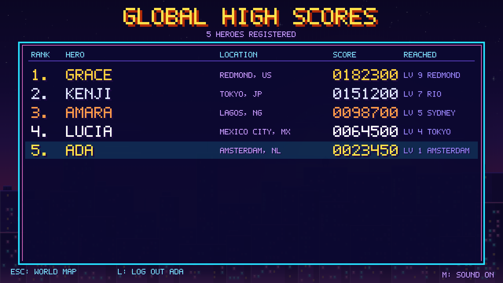
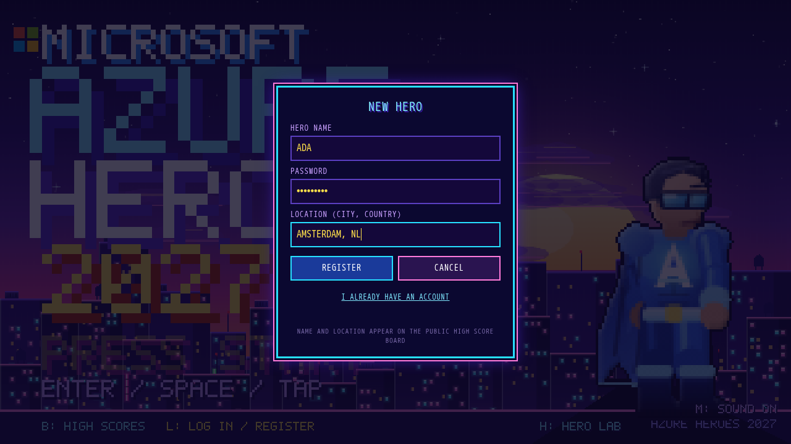

## Deploy

### Azure App Service (accounts + leaderboard)

1. Create a Linux Web App with the **Node 20 LTS** runtime, for example:

   ```bash
   az webapp up --name <app-name> --resource-group <rg> --runtime "NODE:20-lts" --sku B1
   ```

2. Set the app setting `DATA_DIR=/home/data` so the store lives on persistent storage (`az webapp config appsettings set --name <app-name> --resource-group <rg> --settings DATA_DIR=/home/data`).
3. The startup command is `npm start` (App Service runs it by default because `package.json` has a `start` script). App Service provides `PORT`.
4. For continuous deployment, `.github/workflows/azure-app-service.yml` runs the tests and deploys on every push to `main`. Add the repository variable `AZURE_WEBAPP_NAME` and the secret `AZURE_WEBAPP_PUBLISH_PROFILE`.

The JSON store is designed for a single instance. To scale out to more instances, move the store to Azure Table Storage or Cosmos DB.

### Static hosting (guest mode)

- **GitHub Pages:** Settings > Pages > deploy from the `main` branch, root folder.
- **Azure Static Web Apps:** point the app location at the repository root, leave the API and output locations empty, and skip the build.

## Screenshots


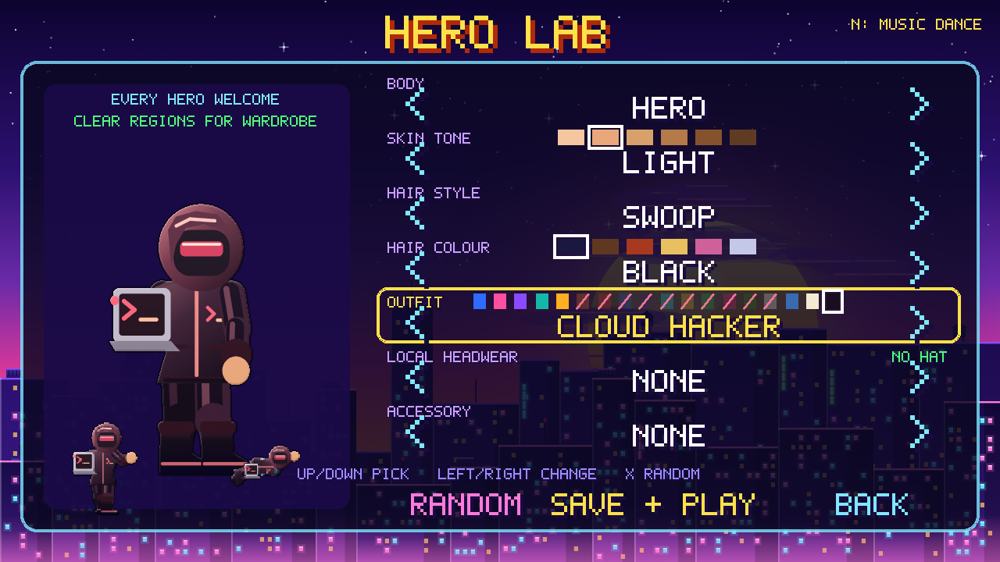


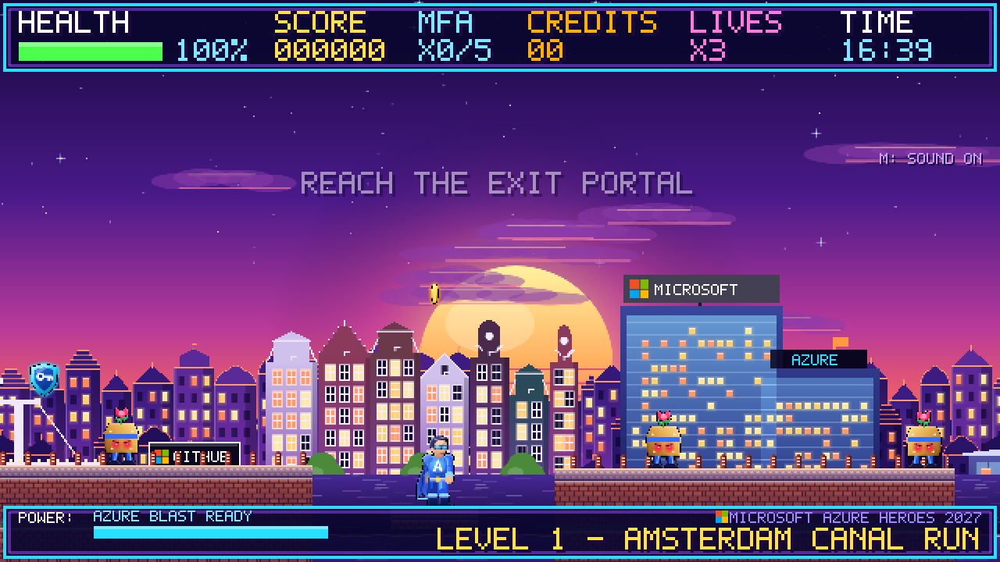
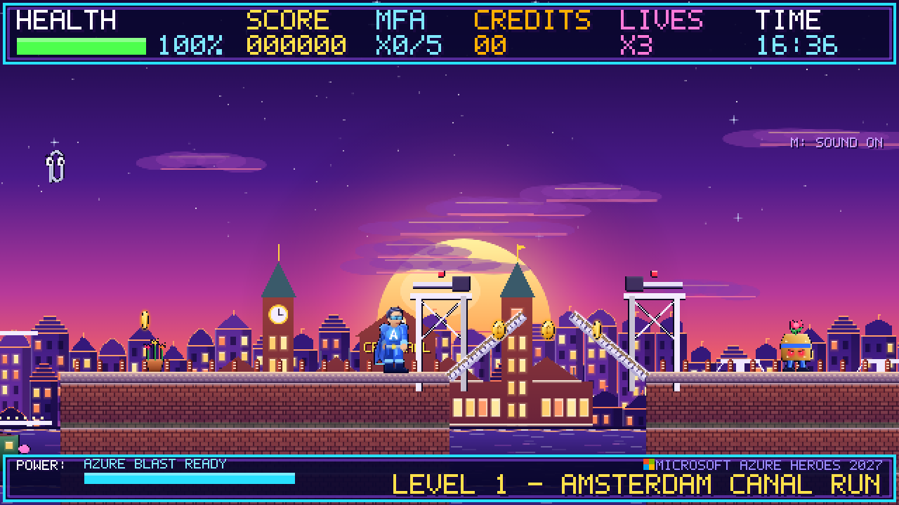
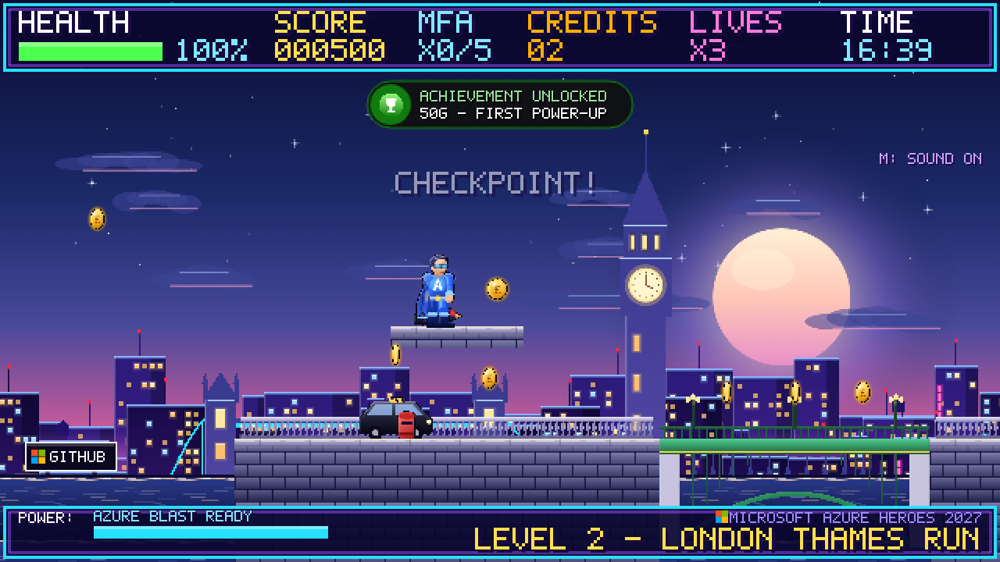


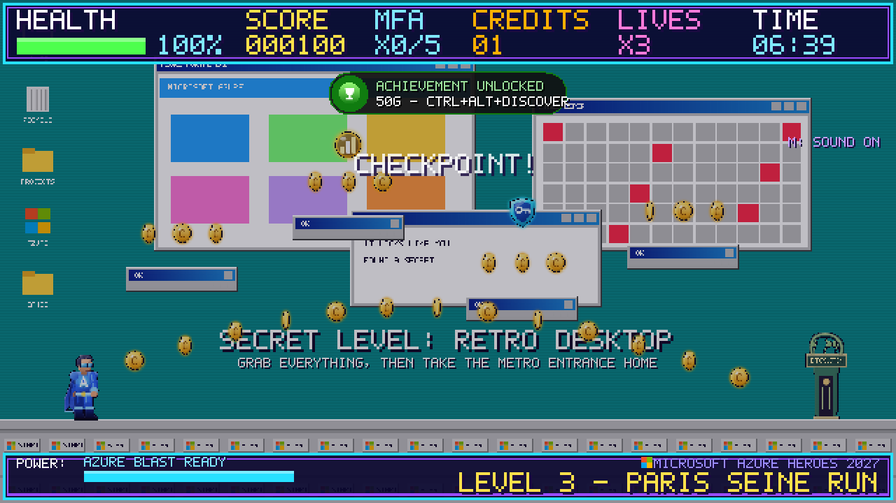


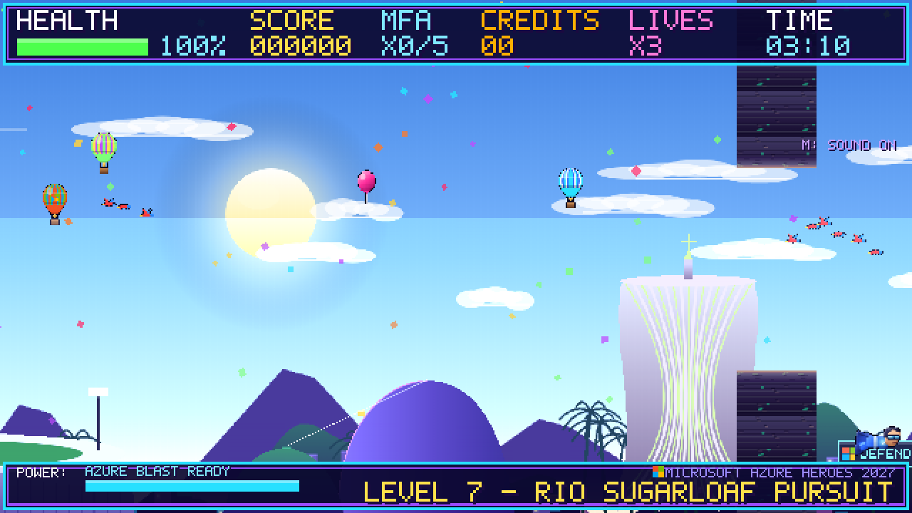
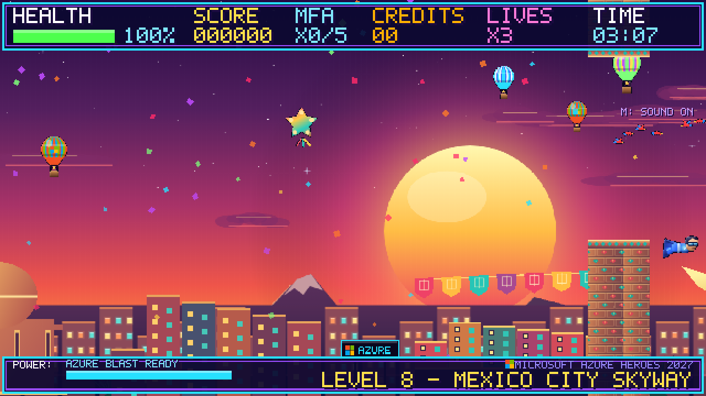
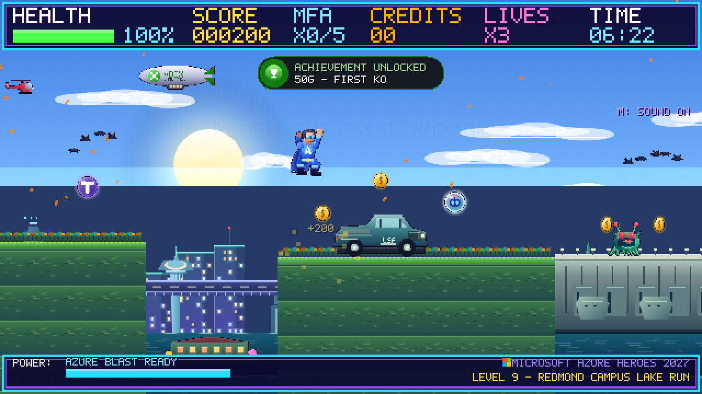
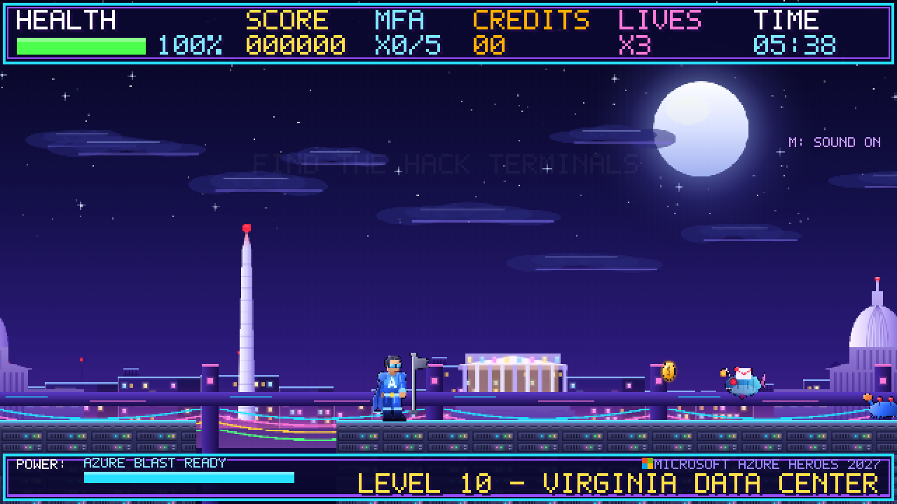
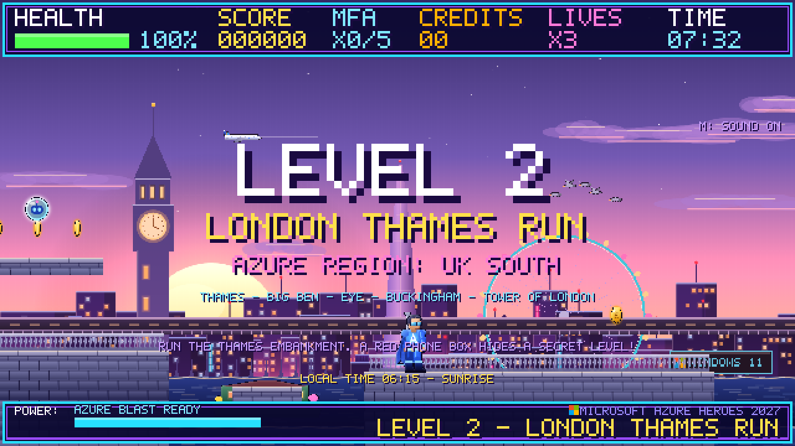
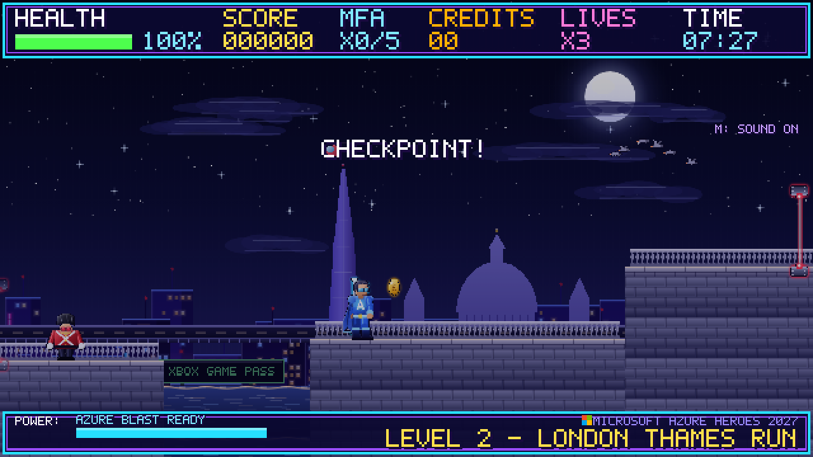
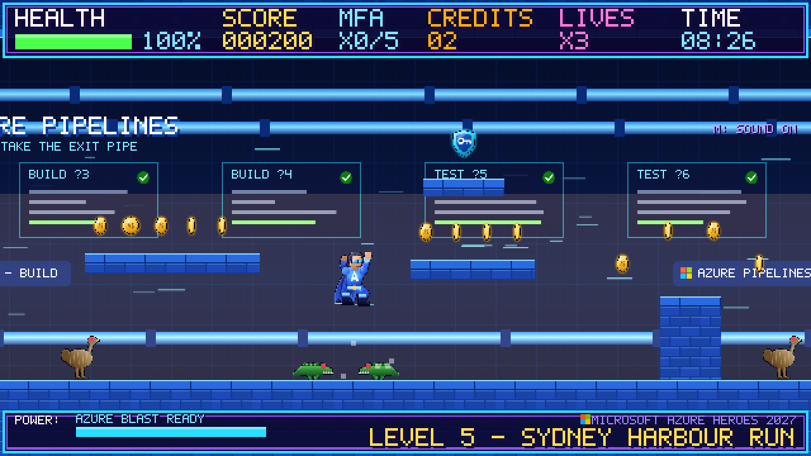
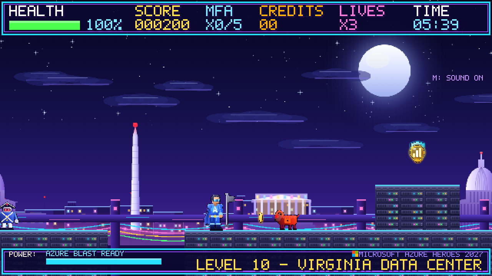
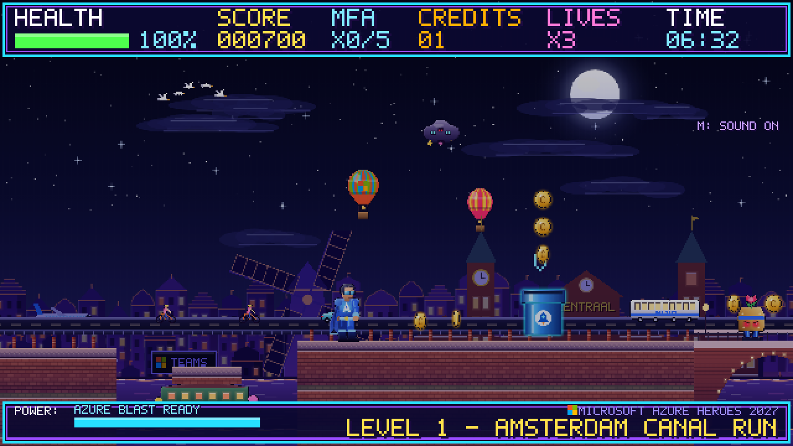
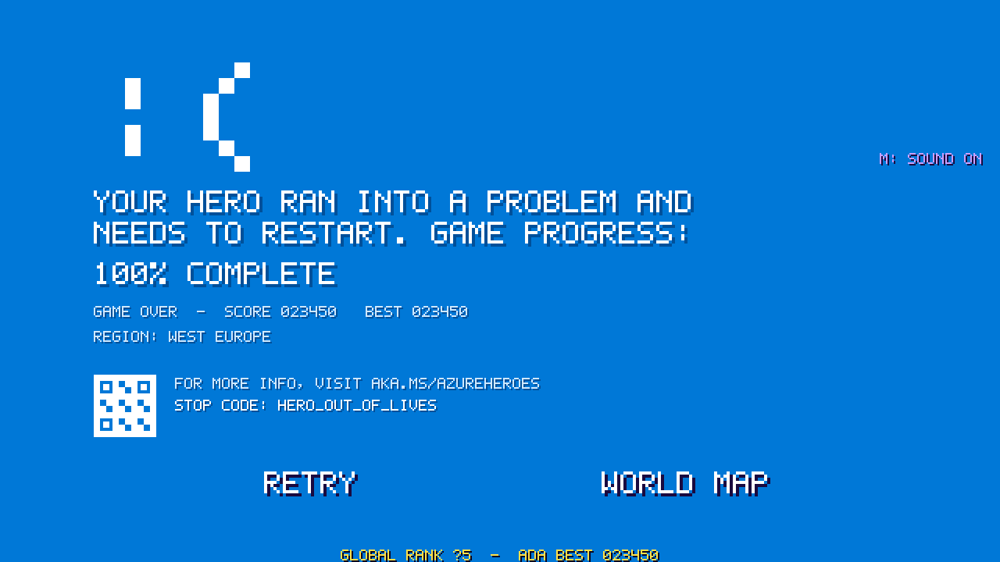


Read the write-up in [docs/article.md](docs/article.md).
