# Microsoft Azure Heroes 2027

A 16-bit synthwave side-scrolling adventure built with **Phaser 3** (loaded from a CDN), plain HTML, CSS and JavaScript. There is no build step, no backend and no image or audio files: every sprite and background is drawn in code and every sound is synthesised with the Web Audio API.

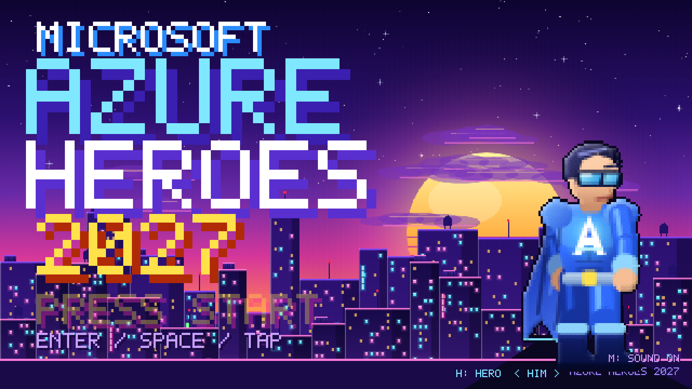

## Play

Open `index.html` in a browser (an internet connection is needed for the Phaser CDN). You can also serve the folder with any static server:

```bash
python3 -m http.server 8080
# then browse to http://localhost:8080
```

## Levels

| Level | Azure region | World | Local enemies | Boss | Mode |
|-------|--------------|-------|---------------|------|------|
| 1 | `westeurope` | Amsterdam Canal Run: windmill, canal houses, Westerkerk | clog bots, windmill drones, cheese crawlers | Windmill Titan | Run |
| 2 | `uksouth` | London Thames Run: Big Ben, Tower Bridge, London Eye, the Shard | bearskin guards, ravens, black-cab crawlers | Bearskin Sentinel | Run |
| 3 | `japaneast` | Tokyo Skyway Pursuit: Mount Fuji, Tokyo Tower, torii, pagoda | sushi drones | Sumo Shogun (hovering) | Flight |
| 4 | `australiaeast` | Sydney Harbour Run: Opera House, Harbour Bridge | emus, cockatoos, crocodiles | Boxing Roo | Run |
| 5 | `brazilsouth` | Rio Sugarloaf Pursuit: Christ the Redeemer, Sugarloaf | macaw drones | Carnaval Rei (hovering) | Flight |
| 6 | `eastus` | Virginia Data Center: Capitol, Washington Monument, hack terminals, Sec Gates | Minutemen, bald eagles, crabs | High-Risk CyberGuardian | Data center |

Levels are generated at random each time a level starts, so platforms, lasers, enemies, coins, power-ups and MFA tokens land in new places on every run. Each level is 7,500 to 13,500 px long. Run levels mix gaps, steps up, drops and floating upper platforms at different heights, and every region has its own coins (EUR, GBP, JPY, AUD, BRL, USD) and scenery props.

Every level ends in an arena with that region's boss. Ground bosses must be blocked with the MFA Shield until they are stunned. Hovering bosses (Tokyo, Rio) cannot be blocked: dodge their volleys, then blast them while they are exposed. The exit opens when the boss is down.

### Power-ups

| Orb | Effect |
|-----|--------|
| Copilot | A sidekick auto-fires Azure Blasts at nearby enemies for 12 s |
| Defender | Invincible for 8 s |
| GitHub Actions | Turbo speed for 9 s |
| Power BI | Coin magnet and double score for 12 s |
| Teams | Instant +30 health |

Clippy warns you when health is low, and Xbox-style achievements pop up for firsts. Pick a hero on the title screen with **H** or by tapping the hero (male or female); the choice is saved.

Collect 5 MFA tokens for an extra life. Every enemy takes 2 hits and drops an Azure Credit. Best score and unlocked levels are stored in `localStorage`.

## Controls

| Action | Keyboard | Touch |
|--------|----------|-------|
| Move | Arrow keys / WASD | Left / Right buttons |
| Jump / Double jump | Space (double-tap for double jump), Up, W | Jump button |
| Azure Blast (costs Boost) | F | Attack button |
| Flight Boost | Shift | - |
| MFA Shield (blocks boss attacks) | E, S or Down | - |
| Pause / Restart / Mute | P / R / M | Pause button |

Add `?touch=1` to the URL to force the touch controls on a desktop browser.

## Project layout

The layout follows the project skills in `.github/skills/`.

```
index.html          entry point, Phaser config, script order
art/sprites.js      every sprite, tile, background and the pixel font
ui/hud.js           read-only HUD
levels/worlds.js    Azure region worlds and random level generators (see the game-contract skill)
systems/            audio and save, input, player, enemies, boss, scenes
tests/playtest.md   QA report
docs/               article and screenshots
```

## Deploy

The site is static, so no build configuration is needed.

- **GitHub Pages:** Settings > Pages > deploy from the `main` branch, root folder.
- **Azure Static Web Apps:** point the app location at the repository root, leave the API and output locations empty, and skip the build.

## Screenshots

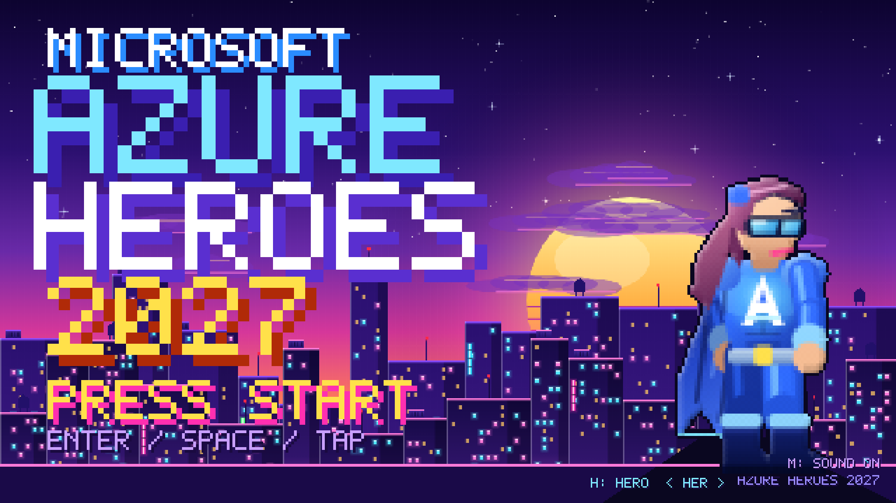
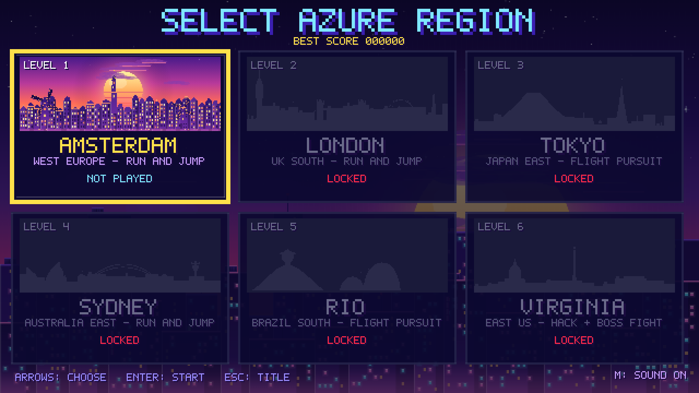
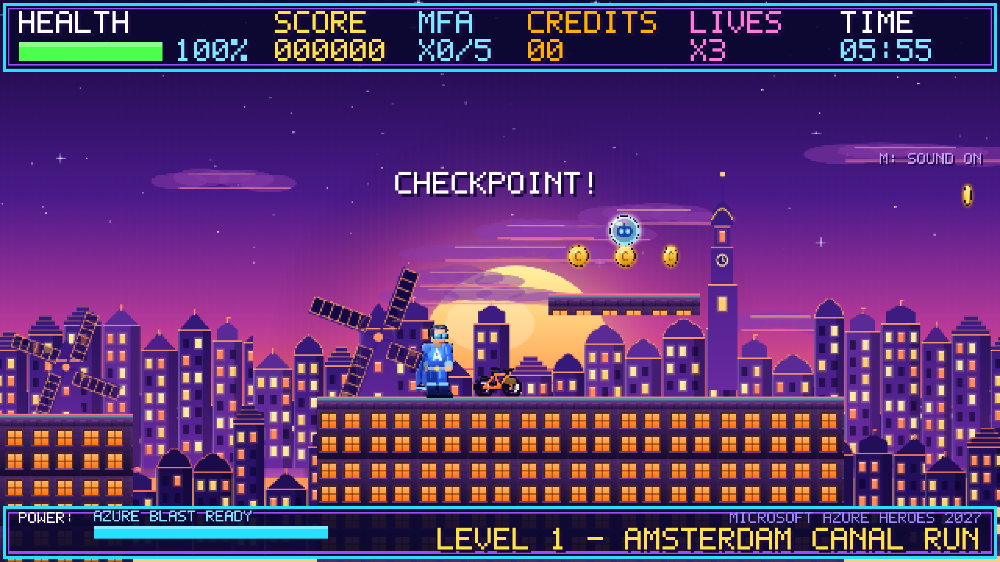
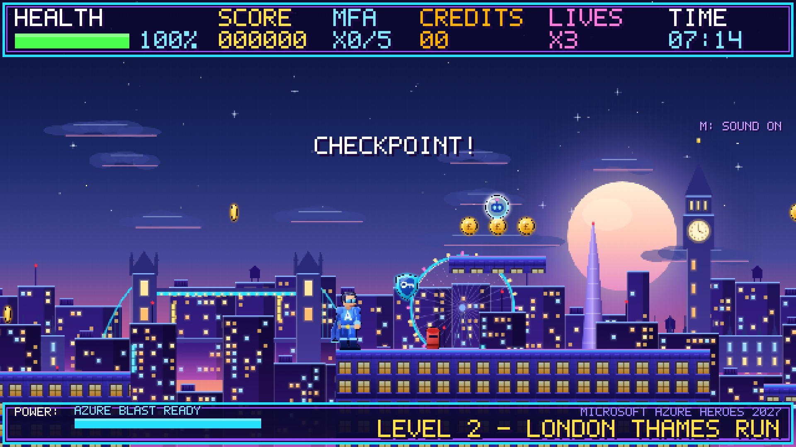
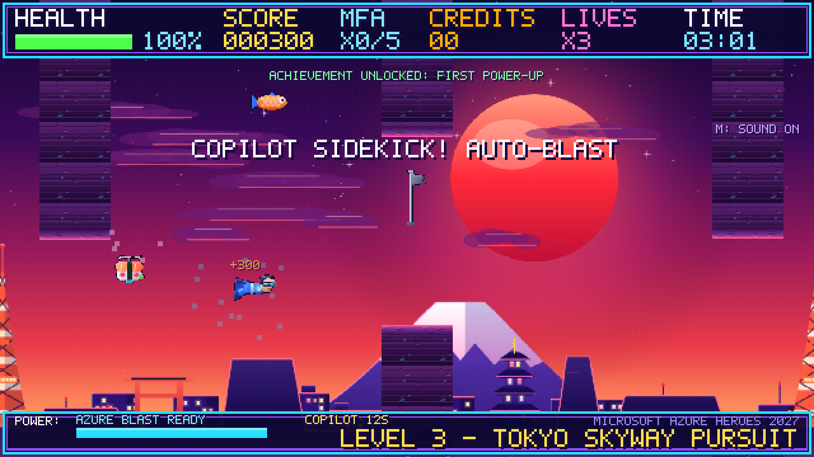
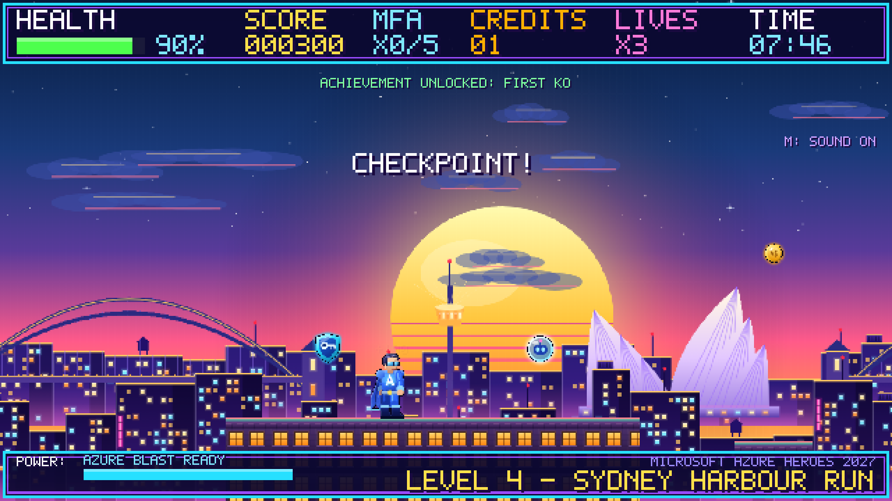
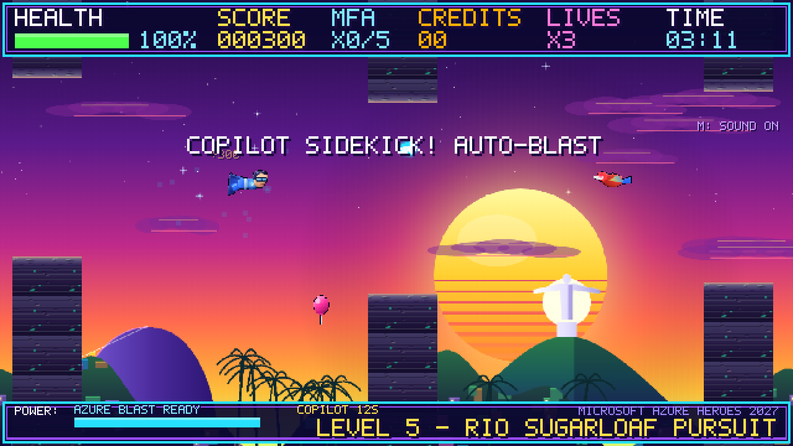
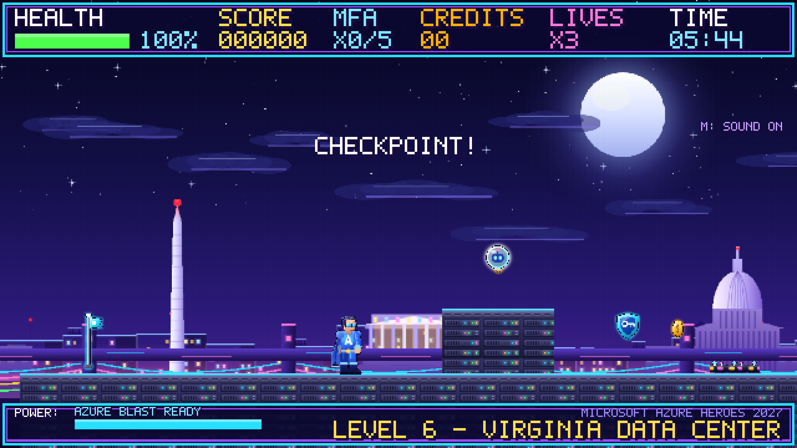
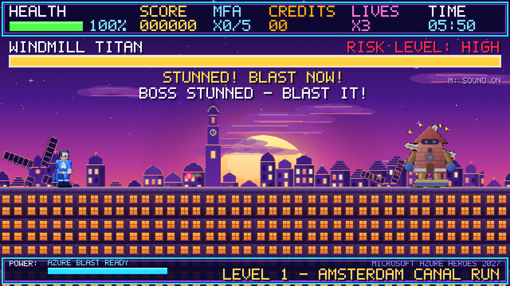
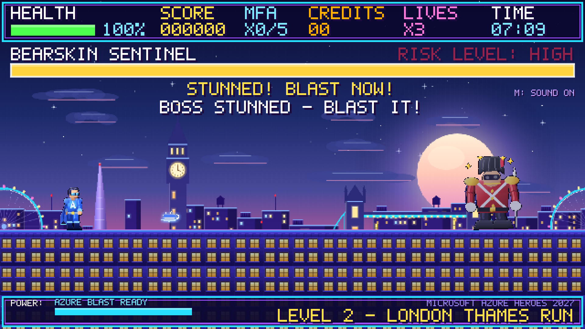
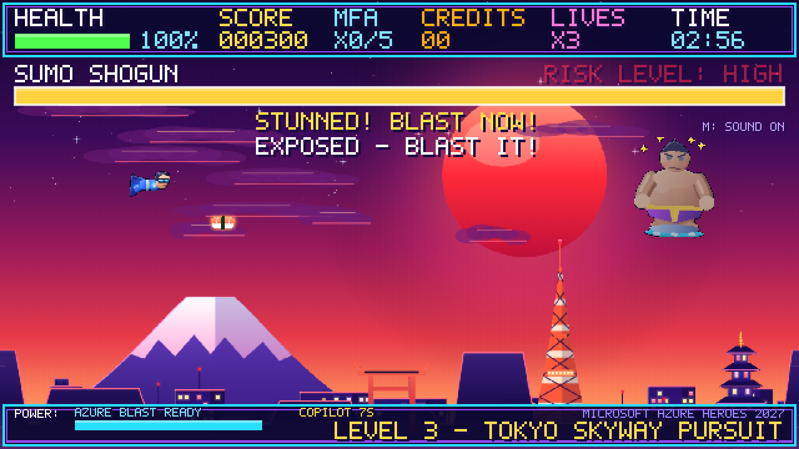
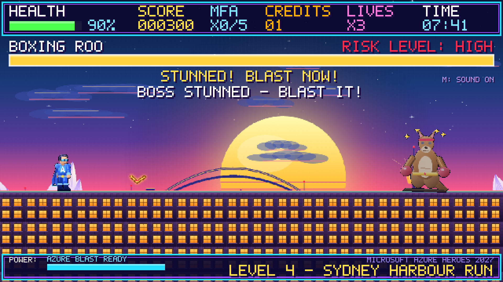
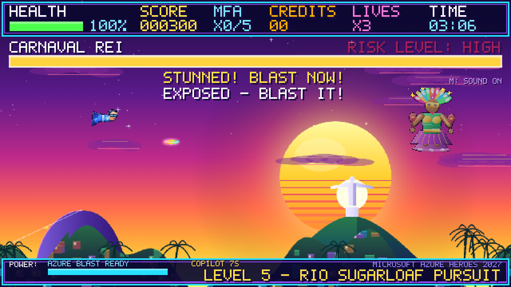
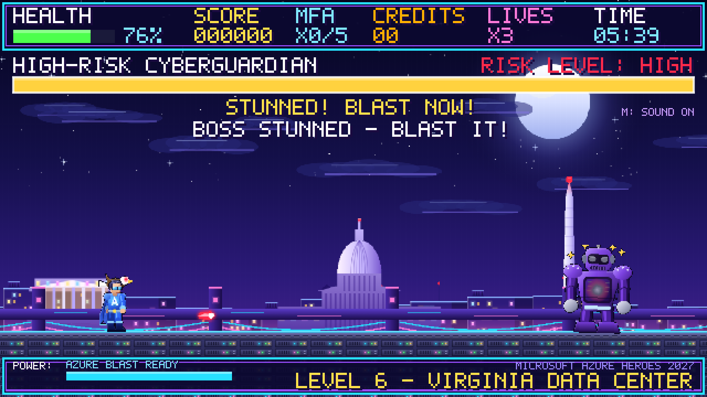

Read the write-up in [docs/article.md](docs/article.md).
