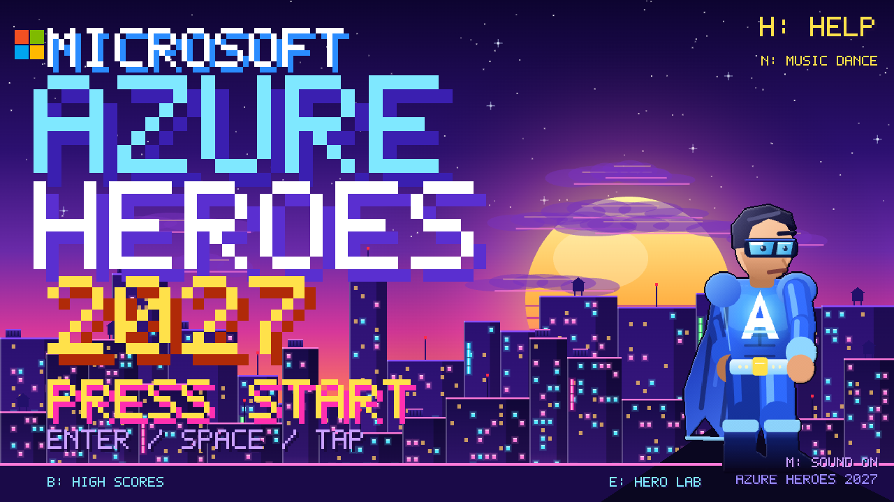
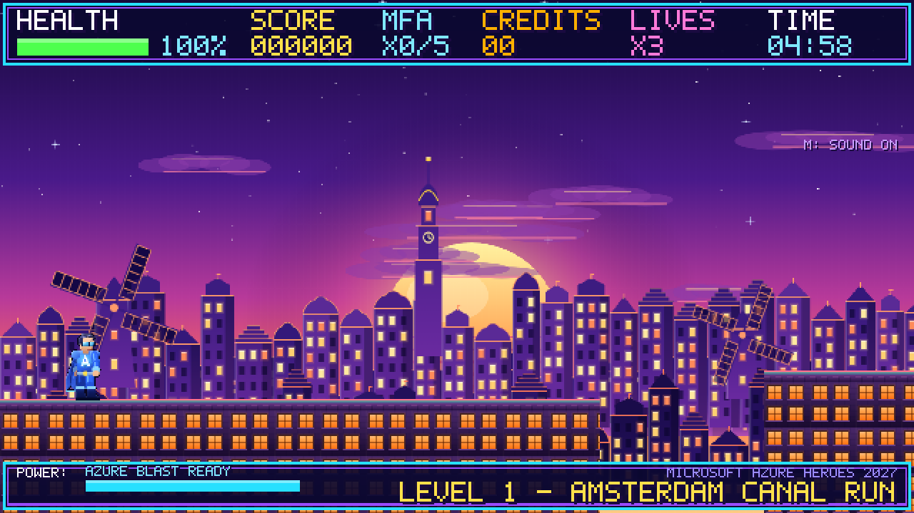
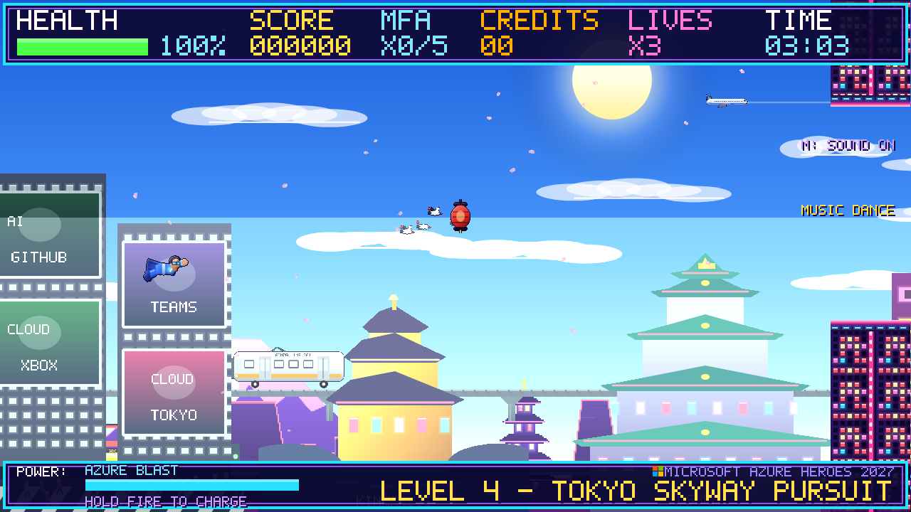
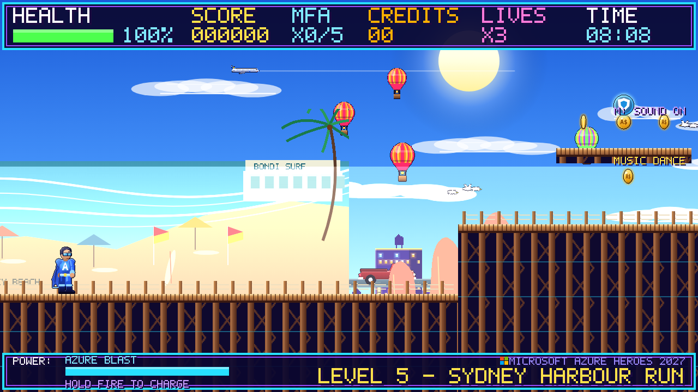
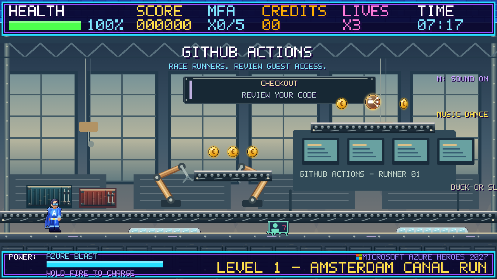
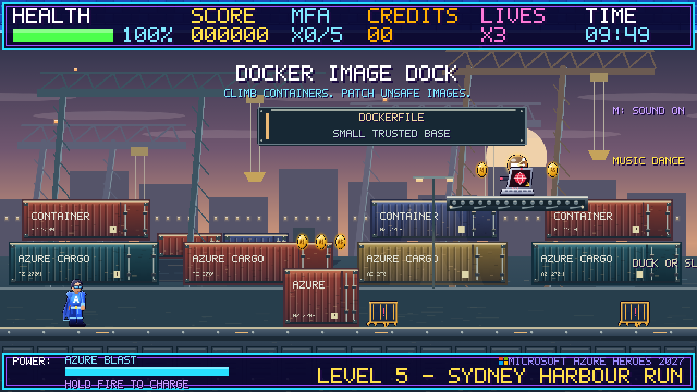
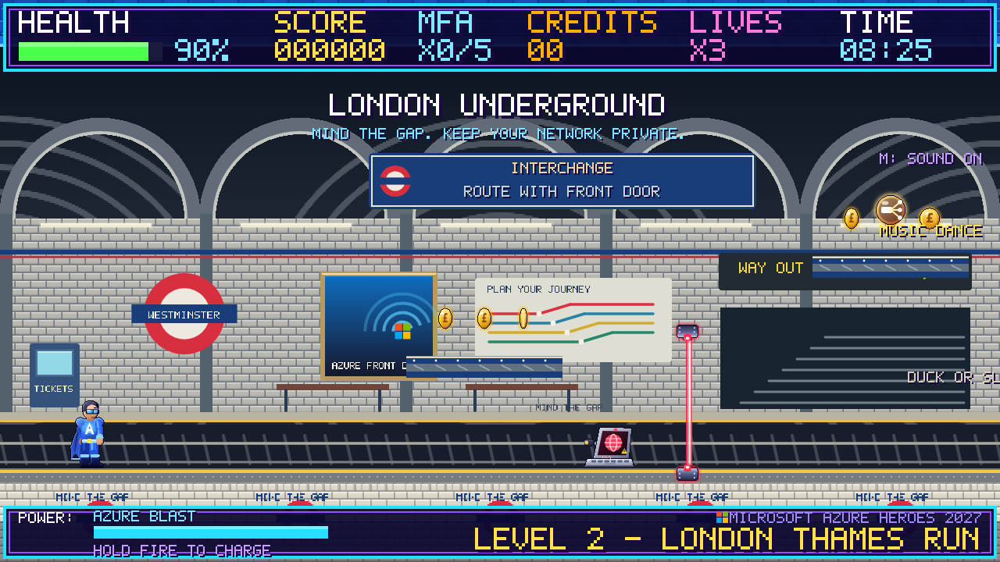
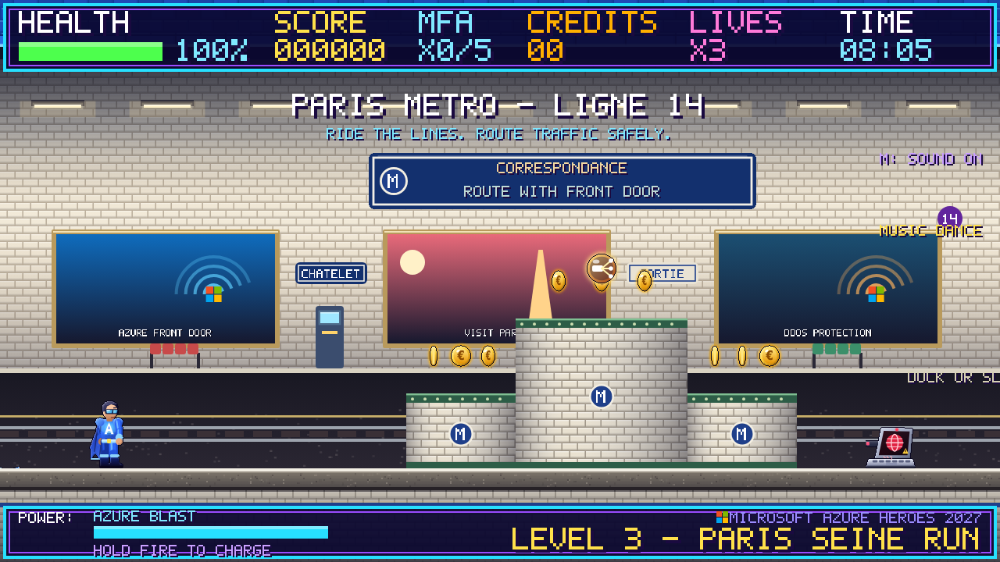
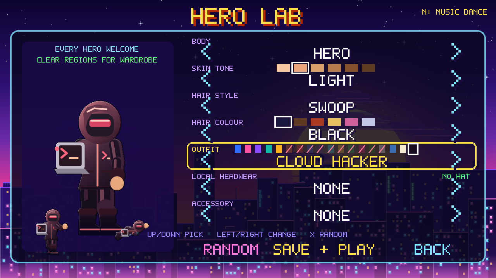
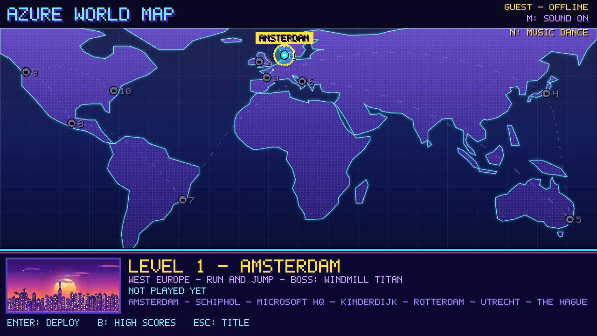

# Building Microsoft Azure Heroes 2027 with no runtime assets or build step

Microsoft Azure Heroes 2027 is a retro side-scroller about a security hero travelling
through eleven Azure-backed worlds, from the canals of Amsterdam to New York's Hudson waterfront.
Players can customize their hero, explore regional streets and transit, and face
cloud-themed threats and a local boss in each world.

The game uses HTML, CSS and JavaScript, with Phaser 3 loaded from an integrity-pinned
CDN. It needs no build step or runtime image and audio files. Static guest play
needs no game server, but an internet connection is needed to load Phaser.

## Everything is drawn in code

There are no sprite sheets. Shared [art modules](../art/) and
[city art modules](../worlds/) draw sprites and backgrounds on canvases and hand
them to Phaser as textures. Pixel shapes are
upscaled and lit with outlines, rim light, shading, dithering and glows. Parallax
skylines, landmarks, moving traffic and a custom bitmap font complete the scene.
The game renders at 1280x720 while retaining 640x360 logical coordinates.

## Eleven worlds, three play styles

- **Street runs** mix canal quays, promenades and piers with gaps, steps, higher
  paths, moving boats, hazards and wall-jump opportunities.
- **Flight worlds** auto-scroll through the sky, with airborne enemies, obstacles,
  rings and Flight Boost.
- **Virginia's data center** adds hack terminals, security gates and cables.

Each run generates a new layout; outdoor worlds also get a random time of day.
Amsterdam has trams, yellow trains,
canal cruises and herring stands. London has a Thames promenade and Underground;
Paris has rooftops, bakeries, Seine boats and the Metro. Tokyo combines flight,
billboards, trains and cherry blossoms, while Sydney features a beach and outback.
New York adds the Statue of Liberty, an Art Deco skyline, Brooklyn Bridge,
brownstones, Times Square, yellow cabs and hot dog carts. Rat and pigeon skins retain
their cloud-threat labels and shared combat rules. Its East US 2 hosting-region
mapping is explicit; the map pin marks New York, not a purported local datacenter.
Landmarks may come from across each country, not just its region's city.

World definitions, map coordinates, local art, wardrobe rewards and regional music
live together in [city folders](../worlds/), with stable order in
[the catalogue](../worlds/catalogue.js). Reusable generators live in
[levels/](../levels/); [levels/worlds.js](../levels/worlds.js) provides the public facade.
Adding a region involves its configuration, generated routes, original art, boss,
map/progression wiring and tests, not just a single level file. The shared
[contribution workflow](../CONTRIBUTING.md) explains the contract and skill framework.

## Cloud challenges and regional transit

Street-world pipes lead to five-stage underground challenges with shuffled layouts,
hazards, rewards and extra time. Six shared themes cover Azure Pipelines, AKS,
GitHub Actions, Docker, Entra and Azure Functions. London and Paris each have a
first pipe dedicated to the Underground or Metro, respectively. Their second
pipe uses a shared theme.

Docker and AKS use shipping-container docks; Actions and Pipelines use industrial
workshops. The transit rooms have station signs and passing trains. Seven layout
templates vary the routes inside the eight room themes, including duck-height ducts,
upper walkways and laser crossings.

## Combat, bosses and Hero Lab

Phishing hoppers, Ransomware chargers, DDoS clouds, Rogue Hackers and cloud threats
such as pipeline bugs and exposed endpoints teach security concepts through their
nameplates and tips. Players can duck, slide, wall-jump, block with the MFA Shield,
or tap and release the blaster. Holding fire charges a stronger shot; temporary
Spread and Cosmos Beam pickups change the weapon.

Every region ends with a three-round street-fighter duel against a local cyber
criminal, from a Muay Thai access broker in Amsterdam to a zero-day luchador in
Mexico City. Fighters face you, close the distance and mix projectiles with combos,
jump kicks and uppercuts; a missed melee move leaves them open to punishment.
A red **ARMORED** indicator means attacks will
not damage it; a green **OPEN** indicator, target marker and countdown identify
the damage window. Ground bosses can be opened by blocking or by dodging a charge
into the arena wall; all bosses also overheat after repeated attacks. Hovering bosses
must be dodged rather than blocked.

Hero Lab offers body, skin, hair, outfit, headwear and accessory choices.
Individual wardrobe caches in regional secrets, sub-levels or side routes unlock
local clothing; clearing a region alone does not. Afro, braids, curls, coils and
waves are base choices, as is religious headwear such as the hijab. The New York
cap, cork hat and cowboy hat require collection even on legacy saves; cowboy can
be found in any of the three US worlds. Classic outfits, including the capeless
Cloud Hacker, remain available from the start.

## A world map and optional accounts

The world map tracks individually opened regions, completed routes and the Continue
point. Registration lets players choose a represented Azure region as their starting
world, without location tracking. Each clear selects a random uncleared world and
saves that exact Continue destination; existing saves retain their progress.
Locally dressed guides explain the deployment key, relay, two gems and three
enemy-carried tokens at the start; gameplay waits for acknowledgment. The pause
menu can reopen the briefing without resetting progress.
Guest progress is stored locally. When hosted with `server.js`, players can also
register, sync their progress and compete on a leaderboard. The zero-dependency
Node.js server uses salted scrypt passwords, hashed expiring tokens, rate limits and
a JSON store; the static site remains playable without an account.

## Sound without files

[systems/audio.js](../systems/audio.js) schedules effects and music with Web Audio,
using shared [composition and synth tools](../audio/) and city song data.
[systems/save.js](../systems/save.js) owns persistence independently of playback.
Players choose **trance, house or pop** with N or the MUSIC button.
Each style has title, world, challenge and boss arrangements; the choice is stored
on the device independently of online progress. M mutes music and effects.

## Testing and running

See the README's [specific-world and challenge instructions](../README.md#testing-a-specific-world-or-challenge)
for guest profiles, world IDs, pipe inspection and developer-console navigation.
These shortcuts, including the teleport used for some screenshots, are assisted
setup rather than evidence of an unassisted playthrough. The
[playtest report](../tests/playtest.md) records checks and their limitations.

Open `index.html` or use a static host for guest mode. Run `npm start` for the
local account server and `npm test` for the automated suite. See the
[README](../README.md) for controls and hosting, and the
[Azure Web App deployment guide](deployment-azure-web-app.md) for production setup.
